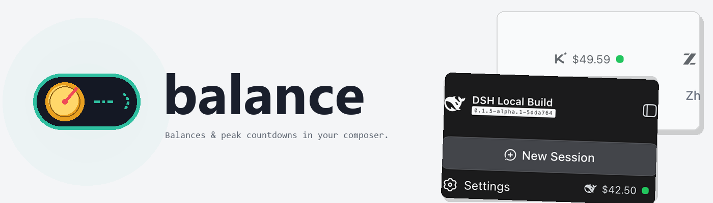
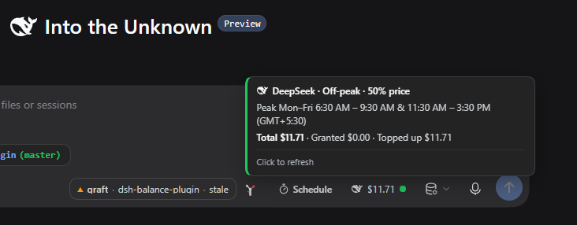
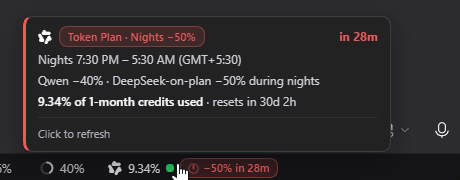
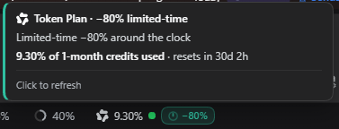
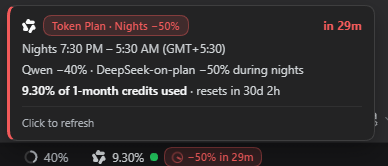

<picture>
  <source media="(prefers-color-scheme: dark)" srcset="assets/banner-dark.png">
  
</picture>

<br>

# dsh-balance-plugin

English | [中文](README.zh-CN.md)

     

A [DeepSeek Harness](https://github.com/deepseek-ai/deepseek-harness) plugin that puts the account balance of whichever provider is serving your current model into the composer dock — with the provider's brand mark, a status dot, and live countdowns for the billing windows that change what a token costs.

It does four things:

- **A chip in the composer** naming the provider and its remaining balance (or plan quota), pinned to the right end of the dock. On a blank session it sits in the hero tool row and flies down to the dock when you send.
- **Billing-window countdowns on the chip**: DeepSeek's peak/off-peak hours and Alibaba Cloud's Token Plan night discount, as tinted pills with a sweeping clock — teal while the cheap window runs, red in the last hour before it opens, waving in the final five minutes.
- **A hover popover in your own local time**: the windows with AM/PM tags and your zone label, the countdown, and the provider's own breakdown (cash/granted, credits, prompts, or Token Plan percent used).
- **Host-side secrets**: the browser never sees an API key. The host resolves it through the credentials seam and talks to the provider alone; Alibaba usage percentages come from your own logged-in `bl` CLI, never from a key this plugin stores.

## Install

From npm:

```sh
pnpm dsh plugin --profile web add @adithyanraj/dsh-balance-plugin
```

Or straight from GitHub:

```sh
pnpm dsh plugin --profile web add github:adithyanraj03/dsh-balance-plugin
```

> The bare `dsh-balance-plugin` name on npm belongs to an unrelated package. Always install the scoped name.

**pnpm 10 and later block `postinstall` scripts from unapproved packages**, and dsh skips writing the plugin's bundle row whenever the install exits non-zero — the dependency lands, the plugin stays invisible. If `add` ends with `ERR_PNPM_IGNORED_BUILDS`, approve and re-run:

```sh
cd ~/.dsh/profiles/web && pnpm approve-builds      # tick @adithyanraj/dsh-balance-plugin
pnpm dsh plugin --profile web add @adithyanraj/dsh-balance-plugin
```

Confirm it mounted — the plugin must appear in **both** `dependencies` and `dsh.profile.bundles`:

```sh
cd ~/.dsh/profiles/web && node -e "const p=require('./package.json');
  console.log(p.dependencies['@adithyanraj/dsh-balance-plugin'],
              p.dsh.profile.bundles.includes('@adithyanraj/dsh-balance-plugin'))"
```

### In the desktop app

Open **Plugins** (settings, left sidebar) → **Add plugin**, paste the repository address, click **Install**:

```
https://github.com/adithyanraj03/dsh-balance-plugin
```

Installed plugins do not update automatically yet — to upgrade, uninstall and install again. The host half loads at startup, so restart the app after installing or upgrading.

## What you get

### The chip

Sits at the right end of the composer dock, after the context meter:

```
🐋 $42.50 ●  ⏱ 2h 14m      DeepSeek, off-peak, peak approaching
☁ 4.22% ●  ⏱ −40% · 6h 02m   Alibaba Token Plan, night discount running
```

Hovering opens the popover; clicking refreshes. The amount is never dropped for the label's sake, and the pill, dot and popover all paint with dsh's own `--dsw-*` theme variables, so they follow the active theme.



Hovering and switching model, live: the popover and the pill follow the selection from a DeepSeek-on-plan model to the Qwen launch promo.



### The providers

| provider | balance source | billing windows |
|---|---|---|
| DeepSeek | `api.deepseek.com/user/balance` | peak Mon–Fri 09:00–12:00 & 14:00–18:00 (UTC+8); off-peak half price |
| Alibaba Cloud Model Studio | Token Plan via the `bl` CLI (optional) | nights 22:00–08:00 (UTC+8): Qwen −40%, DeepSeek-on-plan −50%, qwen4-max-preview −80% all day |
| OpenRouter | `openrouter.ai/api/v1/credits` | — |
| Moonshot / Kimi | `/v1/users/me/balance` (`.ai` / `.cn` mirrors) | — |
| Zhipu / GLM (Z.ai) | account report (bigmodel / z.ai mirrors) | — |
| MiniMax | `/v1/token_plan/remains` | — |

The provider follows the session's model selection, including modlens vision wrappers and custom openai-compat channels aimed at Model Studio (Qwen model names identify those). Model Studio sessions wear the **Qwen knot** on the chip — the models being billed are Qwen-family, and the knot reads better at 14px than the Alibaba Cloud bracket.

### Alibaba usage percentages

Model Studio's quota gateway accepts console-login or AccessKey-derived tokens only — never a model API key — so the chip reads your usage through the official CLI instead of storing any secret:

```sh
npm install -g bailian-cli
bl auth login --console        # browser login; international accounts add --console-site international
```

With `bl` installed and logged in, the chip shows percent used and the window reset countdown (`4.22% · resets in 1d 6h`); without it, the chip runs in night-discount-only mode and says where the credits live. Readings cache for five minutes.

Live captures from a Model Studio session — the all-day launch promo, and the last hour before nights open on a DeepSeek-on-plan model:





## Configuration

All optional:

| knob | default | meaning |
|---|---|---|
| `DSH_BALANCE_MOCK=1` or `?mock=1` | off | canned balances for every provider, no account needed |
| `DSH_BALANCE_BL` | `bl` on PATH | path to the Model Studio CLI binary |

Provider keys resolve from `~/.dsh/.credentials.yaml` first, then the environment (`DEEPSEEK_API_KEY`, `OPENROUTER_API_KEY`, `MOONSHOT_API_KEY`, `ZAI_API_KEY`/`GLM_API_KEY`/`ZHIPU_API_KEY`, `MINIMAX_API_KEY`). Alibaba needs no key at all.

## Requirements

- a DeepSeek Harness web profile (`dsh web`) or the desktop app
- Node ≥ 22.18
- one API key for whichever provider you use (Alibaba excepted)

## Development

```sh
pnpm install
pnpm run build                  # tsdown: host ESM + client CJS
node scripts/verify-client.mjs  # bundle contract, slot registration, provider resolution
node --test test/*.test.mjs     # 33 tests against the built bundle
python scripts/make-banner.py   # regenerate the README banners (Pillow)
```

## Troubleshooting

**No chip and dsh started without errors.** The plugin is in `dependencies` but not in `dsh.profile.bundles` — the pnpm 10+ ignored-builds trap above. Approve, re-add, restart.

**Alibaba shows `Token Plan` instead of a percentage.** The `bl` CLI is absent or not logged in; the night-discount pill still works. Install and log in as above, then click the chip.

**A custom channel shows the wrong provider.** Known provider ids win; unknown ids fall back to DeepSeek unless the model name starts with `qwen`. Rename the channel to `alibaba-cloud` (or `dashscope`/`bailian`) to pin it.

## Licence

MIT © 2026 Adithya N Raj

## Credits

- **Initial upstream**: [andregoncalves/dsh-balance](https://github.com/andregoncalves/dsh-balance) by Andre Goncalves (MIT). This plugin forked from that project: the original provider-aware balance chip, the host/client split, the DeepSeek peak/off-peak model, and some of the early screenshot assets come from it. Thank you.
- **Brand marks**: [LobeHub icons](https://github.com/lobehub/lobe-icons) — DeepSeek, OpenRouter, Kimi, Zhipu, MiniMax and Qwen glyphs, rendered in `currentColor`.
- **Alibaba Cloud Token Plan terms**: the official [Model Studio CLI docs](https://www.alibabacloud.com/help/en/model-studio/cli/usage-quota) and [Token Plan blog](https://modelstudio.alibabacloud.com/intl/blog/manage-token-plan-via-cli/), plus the open-source [modelstudioai/cli](https://github.com/modelstudioai/cli) whose auth contract shaped the `bl` bridge.
