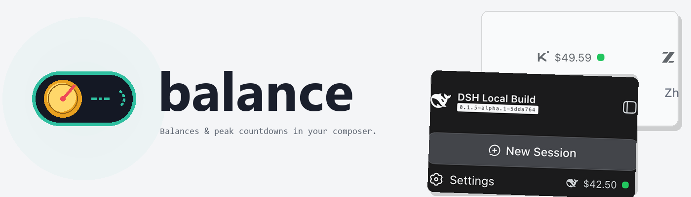
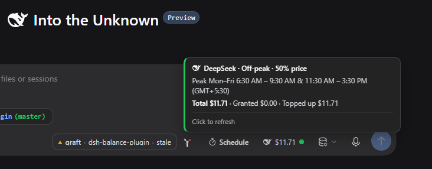
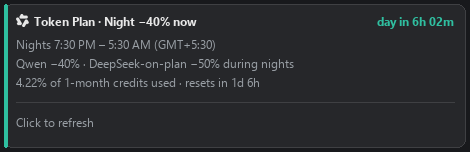

<picture>
  <source media="(prefers-color-scheme: dark)" srcset="assets/banner-dark.png">
  
</picture>

<br>

# dsh-balance-plugin

[English](README.md) | 中文

     

一个 [DeepSeek Harness](https://github.com/deepseek-ai/deepseek-harness) 插件：把当前会话模型所属服务商的账户余额放进 composer  dock——带品牌标识、状态点，以及那些会改变 token 价格的计费窗口的实时倒计时。

它做四件事：

- **composer 里的一枚胶囊**：显示服务商与剩余余额（或套餐额度），固定在 dock 最右端。空白会话时它坐在 hero 工具行，发送第一条消息时飞落到 dock。
- **胶囊上的计费窗口倒计时**：DeepSeek 的高峰/低谷时段与阿里云 Token Plan 的夜间折扣，做成带扫动时钟的着色小药丸——便宜窗口进行时为青色，窗口开启前最后一小时为红色，最后五分钟波浪变色。
- **以你本地时间呈现的悬停弹层**：带 AM/PM 与你的时区标签的窗口、倒计时，以及服务商自己的明细（现金/赠送、credits、 prompts 数或 Token Plan 已用百分比）。
- **密钥留在宿主端**：浏览器永远看不到 API key。宿主通过 credentials seam 解析密钥并独自与服务商通信；阿里云用量百分比来自你自己已登录的 `bl` CLI，而非本插件存储的任何密钥。

## 安装

```sh
pnpm dsh plugin --profile web add github:adithyanraj03/dsh-balance-plugin
```

> 未发布到 npm：npm 上的 `dsh-balance-plugin` 名称属于另一个无关的包。请从 GitHub 或本地克隆安装。

**pnpm 10 及以后会拦截未批准包的 `postinstall` 脚本**，而安装一旦非零退出，dsh 就跳过写入 bundle 行——依赖装上了，插件却不可见。若 `add` 以 `ERR_PNPM_IGNORED_BUILDS` 结束，批准后再跑一次：

```sh
cd ~/.dsh/profiles/web && pnpm approve-builds      # 勾选 dsh-balance-plugin
pnpm dsh plugin --profile web add github:adithyanraj03/dsh-balance-plugin
```

确认挂载成功——插件必须同时出现在 `dependencies` 与 `dsh.profile.bundles` 中：

```sh
cd ~/.dsh/profiles/web && node -e "const p=require('./package.json');
  console.log(p.dependencies['dsh-balance-plugin'],
              p.dsh.profile.bundles.includes('dsh-balance-plugin'))"
```

### 桌面应用内

打开 **Plugins**（设置、左侧栏）→ **Add plugin**，粘贴仓库地址，点击 **Install**：

```
https://github.com/adithyanraj03/dsh-balance-plugin
```

已安装插件尚不会自动更新——升级请先卸载再安装。宿主半在启动时加载，安装或升级后请重启应用。

## 你会得到什么

### 胶囊

坐在 composer dock 最右端、上下文计量之后：

```
🐋 $42.50 ●  ⏱ 2h 14m      DeepSeek，低谷中，高峰临近
☁ 4.22% ●  ⏱ −40% · 6h 02m   阿里 Token Plan，夜间折扣进行中
```

悬停打开弹层；点击刷新。金额永远不会为标签让位；药丸、状态点与弹层全部使用 dsh 自己的 `--dsw-*` 主题变量绘制，跟随当前主题。



### 服务商

| 服务商 | 余额来源 | 计费窗口 |
|---|---|---|
| DeepSeek | `api.deepseek.com/user/balance` | 高峰 周一至周五 09:00–12:00 与 14:00–18:00（UTC+8）；低谷半价 |
| 阿里云百炼 Model Studio | Token Plan，经 `bl` CLI（可选） | 夜间 22:00–08:00（UTC+8）：Qwen −40%、plan 内 DeepSeek −50%、qwen4-max-preview 全天 −80% |
| OpenRouter | `openrouter.ai/api/v1/credits` | — |
| Moonshot / Kimi | `/v1/users/me/balance`（`.ai` / `.cn` 镜像） | — |
| 智谱 / GLM（Z.ai） | 账户报告（bigmodel / z.ai 镜像） | — |
| MiniMax | `/v1/token_plan/remains` | — |

服务商跟随会话的模型选择，包括 modlens 视觉包装路由，以及指向百炼的自定义 openai-compat 通道（Qwen 模型名即可识别）。百炼会话的胶囊佩戴 **Qwen 结**标识——被计费的是 Qwen 系模型，且该标识在 14px 下比阿里云括号更清晰。

### 阿里云用量百分比

百炼的配额网关只接受控制台登录或 AccessKey 换发的 token——绝不接受模型 API key——因此胶囊通过官方 CLI 读取用量，而不存储任何密钥：

```sh
npm install -g bailian-cli
bl auth login --console        # 浏览器登录；国际站账号加 --console-site international
```

`bl` 已安装并登录后，胶囊显示已用百分比与窗口重置倒计时（`4.22% · resets in 1d 6h`）；否则胶囊运行在仅夜间折扣模式，并说明额度在控制台查看。读数缓存五分钟。

阿里云胶囊与弹层的设计预览（由 `scripts/make-chip-preview.py` 渲染；实际会话显示你自己的数字）：




## 配置

全部可选：

| 开关 | 默认 | 含义 |
|---|---|---|
| `DSH_BALANCE_MOCK=1` 或 `?mock=1` | 关 | 每个服务商的 canned 余额，无需账户 |
| `DSH_BALANCE_BL` | PATH 上的 `bl` | 百炼 CLI 可执行文件路径 |

服务商密钥先解析 `~/.dsh/.credentials.yaml`，再回退环境变量（`DEEPSEEK_API_KEY`、`OPENROUTER_API_KEY`、`MOONSHOT_API_KEY`、`ZAI_API_KEY`/`GLM_API_KEY`/`ZHIPU_API_KEY`、`MINIMAX_API_KEY`）。阿里云完全不需要密钥。

## 要求

- DeepSeek Harness web profile（`dsh web`）或桌面应用
- Node ≥ 22.18
- 所用服务商的一枚 API key（阿里云除外）

## 开发

```sh
pnpm install
pnpm run build                  # tsdown：宿主 ESM + 客户端 CJS
node scripts/verify-client.mjs  # bundle 契约、slot 注册、服务商解析
node --test test/*.test.mjs     # 33 个针对构建产物的测试
python scripts/make-banner.py   # 重新生成 README 横幅（Pillow）
python scripts/make-chip-preview.py  # 重新生成阿里云设计预览
```

## 故障排查

**没有胶囊且 dsh 启动无报错。** 插件在 `dependencies` 里但不在 `dsh.profile.bundles` 里——即上文 pnpm 10+ 的 ignored-builds 陷阱。批准、重新 add、重启。

**阿里云显示 `Token Plan` 而非百分比。** `bl` CLI 未安装或未登录；夜间折扣药丸仍工作。按上文安装登录后点击胶囊。

**自定义通道显示了错误的服务商。** 已知 provider id 优先；未知 id 回退 DeepSeek，除非模型名以 `qwen` 开头。把通道改名为 `alibaba-cloud`（或 `dashscope`/`bailian`）即可固定。

## 许可证

MIT © 2026 Adithya N Raj

## 致谢

- **初始上游**：Andre Goncalves 的 [andregoncalves/dsh-balance](https://github.com/andregoncalves/dsh-balance)（MIT）。本插件 fork 自该项目：最初的服务商感知余额胶囊、宿主/客户端双面结构、DeepSeek 高峰/低谷模型，以及部分早期截图资产均源于此。致谢。
- **品牌标识**：[LobeHub icons](https://github.com/lobehub/lobe-icons) —— DeepSeek、OpenRouter、Kimi、智谱、MiniMax 与 Qwen 标识，以 `currentColor` 渲染。
- **阿里云 Token Plan 条款**：官方 [Model Studio CLI 文档](https://www.alibabacloud.com/help/en/model-studio/cli/usage-quota) 与 [Token Plan 博客](https://modelstudio.alibabacloud.com/intl/blog/manage-token-plan-via-cli/)，以及开源的 [modelstudioai/cli](https://github.com/modelstudioai/cli)——其鉴权契约决定了 `bl` 桥接的设计。
